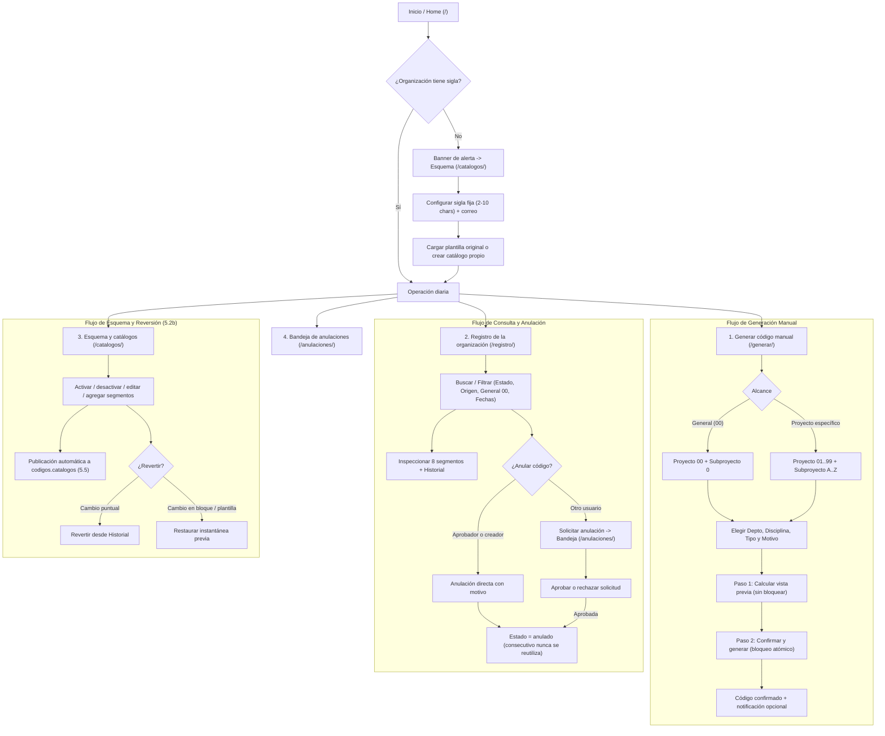
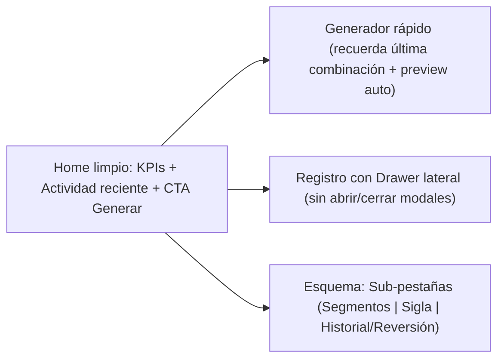

# Auditoría de Interfaces y Flujo de Códigos (`Cereipo · Códigos`)

> Documento de revisión UX/UI y arquitectura de pantallas de **Códigos** (`Codigos/frontend/`), basado en [Cereipo_desing_system.md](../../Cereipo%20Shell/docs/Cereipo_desing_system.md) y en el flujo real de trabajo de los usuarios (administradores, generadores, aprobadores y consulta).

---

## 1. Diagrama de flujo completo del módulo Códigos

---

## 2. Auditoría por pantalla (qué falla hoy y cómo mejorarlo)

### 2.1 Navegación superior (`BarraModulo.tsx`)
- **Qué tenemos hoy:** 6 pestañas (`Inicio`, `Generar código`, `Registro`, `Anulaciones`, `Esquema`, `Administración`) + botón `¿Cómo funciona?` + insignia de organización.
- **Problemas detectados:**
  1. Cuando el usuario está dentro del Shell (`embebida = true`), la barra local se oculta y solo queda el menú lateral del Shell; pero en modo standalone la barra se siente cargada con demasiados botones a la derecha.
  2. La diferencia entre **Esquema** (`/catalogos/`) y **Administración** (`/administracion/`) no es obvia para el usuario final porque ambos muestran la configuración de sigla.
- **Mejora propuesta:**
  - Unificar la configuración de sigla en un solo lugar claro (**Esquema**) y dejar **Administración** únicamente para permisos/ámbitos del Shell.
  - Reducir el ruido visual de la barra superior dejando el botón `?` integrado de forma discreta.

### 2.2 Home (`InicioPage.tsx`)
- **Qué tenemos hoy:** Cabecera con saludo, banda interactiva de 8 segmentos (`General 00` vs `Proyecto 04`), 4 KPIs, tabla de actividad reciente y lista de accesos rápidos.
- **Problemas detectados:**
  1. La **banda de fórmula** ocupa mucho espacio vertical arriba de los KPIs y compite con la acción principal (**Generar código**).
  2. Los **Accesos rápidos** duplican opciones que ya están en la barra de navegación superior (`Generar`, `Catálogos`, `Anulaciones`).
  3. No muestra un resumen claro de **qué falta por configurar** cuando la organización es nueva (ej. checklist: *1. Sigla -> 2. Plantilla -> 3. Primer código*).
- **Mejora propuesta:**
  - **Home orientado a tareas:**
    - Arriba: saludo + **1 CTA principal** (`Generar código`) + **4 KPIs** limpios.
    - Centro: **Actividad reciente** (últimos 8 códigos con búsqueda rápida directa desde Home) + **Pendientes de atención** (si hay solicitudes de anulación o falta sigla/catálogo).
    - Mover la explicación visual de los 8 segmentos a un **banner colapsable** o al botón `?` para no recargar el Home diario.

### 2.3 Generador manual (`GeneradorPage.tsx`)
- **Qué tenemos hoy:** Formulario a la izquierda con selectores buscables, botones `?` en cada campo, y panel fijo a la derecha con el código en tiempo real y botones de vista previa/confirmación.
- **Problemas detectados:**
  1. **Demasiados botones `?` visibles a la vez** (8 iconos `?` en una misma pantalla generan ruido visual).
  2. El flujo en **2 pasos** (`Calcular vista previa` -> `Confirmar y generar`) obliga a hacer 2 clics en el panel derecho, y en modo **Lote** el panel derecho desaparece y cambia la disposición de la pantalla.
  3. Falta un **selector rápido de plantillas/favoritos** (por ejemplo: *"Últimos segmentos usados"* para no volver a elegir Departamento, Disciplina y Tipo cada vez).
- **Mejora propuesta:**
  - Recordar en `localStorage` la **última combinación usada** por el usuario (Departamento, Disciplina, Tipo) para rellenar en 1 clic.
  - Reemplazar los 8 botones `?` individuales por **ayuda contextual al enfocar** el campo (o un único `?` en la cabecera del formulario) para limpiar visualmente la tarjeta.
  - Hacer que la **vista previa del consecutivo** se calcule automáticamente (debounced) al completar los segmentos, dejando un solo botón claro: **«Generar código»** (con confirmación rápida si es lote).

### 2.4 Registro de códigos (`RegistroPage.tsx`)
- **Qué tenemos hoy:** Buscador, chips rápidos (`Vigentes`, `Confirmados`, `Reservados`, `Anulados`, `Generales 00`, `Manual`, `API`), filtros avanzados colapsables, tabla e Inspector modal.
- **Problemas detectados:**
  1. La tabla tiene 8 columnas y en pantallas medianas se siente apretada.
  2. El **Inspector** es un modal centrado que tapa la tabla; al revisar varios códigos seguidos hay que abrir y cerrar constantemente.
- **Mejora propuesta:**
  - Convertir el Inspector en un **panel lateral deslizable (*drawer*)** a la derecha para poder hacer clic de una fila a otra sin cerrar el modal.
  - Compactar columnas: combinar `Alcance` dentro de una sub-etiqueta o tooltip, dejando visible `Código`, `Estado`, `Motivo`, `Responsable`, `Fecha` y `Acciones`.

### 2.5 Esquema y catálogos (`CatalogosPage.tsx`)
- **Qué tenemos hoy:** Mapa de 8 bloques arriba, simulador, pestañas por segmento, formulario colapsable, tabla con edición en línea, botones de lote, restablecer plantilla y modal de historial/reversión.
- **Problemas detectados:**
  1. Tiene **demasiados controles simultáneos** en la parte superior (sigla colapsable, bloques de esquema, simulador, pestañas, barra de filtros, botones de lote).
  2. La tabla de `Proyectos` tiene 100 filas (`00..99`) sin paginación ni agrupación, lo que alarga el scroll.
- **Mejora propuesta:**
  - Separar claramente en **2 vistas/sub-pestañas** dentro de Esquema:
    1. **Catálogo de segmentos** (con paginación o virtualización para listas largas como `00..99`).
    2. **Sigla y notificaciones** (cuando ya está configurada, no compite con la edición de segmentos).
  - Mantener **«Deshacer último»** y **«Historial y reversión»** siempre accesibles en la cabecera.

---

## 3. Flujo ideal propuesto (resumen de simplificación)

