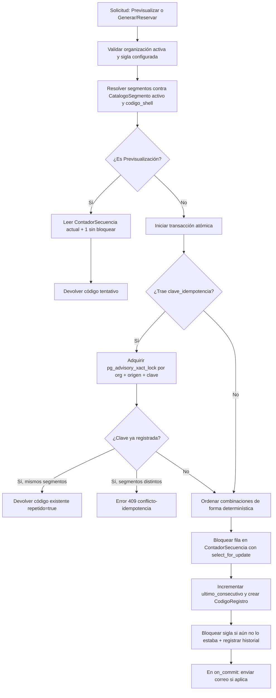

# Nomenclatura de Códigos y Funcionamiento del Motor

Guía funcional y técnica sobre la estructura estándar de 8 segmentos utilizada en **Códigos (Cereipo)** y el funcionamiento interno de su motor de generación, reserva y anulación.

---

## 1. Nomenclatura de los códigos (8 segmentos)

Toda la suite Cereipo utiliza un esquema único e invariable de **8 segmentos separados por guiones (`-`)**:

```text
{SIGLA}-{AA}-{NN}-{S}-{DEPT}-{DISC}-{TIPO}-{CCC}
```

### Ejemplos prácticos

- **Código de proyecto específico:** `CER-26-04-A-IN-M-PLA-012`
  *(Empresa `CER`, año `2026`, proyecto `04`, subproyecto `A`, departamento Ingeniería `IN`, disciplina Mecánica `M`, tipo Plano `PLA`, consecutivo `012`)*.
- **Código general de la organización (regla `00`):** `CER-26-00-0-GG-G-PRO-003`
  *(Empresa `CER`, año `2026`, proyecto general `00`, sin subproyecto `0`, Gerencia General `GG`, disciplina General `G`, Procedimiento `PRO`, consecutivo `003`)*.

### Desglose de cada segmento

| # | Segmento | Formato / Longitud | Origen | Descripción |
| :---: | :--- | :--- | :--- | :--- |
| **1** | **SIGLA** | `2..10` alfanuméricos (mayúsculas) | `ConfiguracionOrganizacion` | Identificador único de la empresa u organización. Se configura una vez y se bloquea automáticamente al emitir el primer código para proteger la trazabilidad histórica. |
| **2** | **AA** | `2` dígitos (`2015–2100`) | Fecha / usuario | Últimos dos dígitos del año documental (ej. `2026` → `26`). Permite que cada año inicie su numeración desde `001` sin colisionar con años anteriores. |
| **3** | **NN** | `2` dígitos (`00–99`) | Catálogo `proyecto` | Número de proyecto. **`00` significa General** (documentos transversales de la organización que no pertenecen a una obra específica). |
| **4** | **S** | `1–2` alfanuméricos (`A–Z`, `0`, `00`) | Catálogo `subproyecto` | Subdivisión o frente del proyecto (`A`, `B`, `C`…). **`0` o `00`** cuando es código general o el proyecto no tiene subdivisiones. |
| **5** | **DEPT** | `2..10` alfanuméricos | Catálogo `departamento` | Área responsable de emitir o custodiar el entregable (ej. `IN` Ingeniería, `GG` Gerencia General, `CD` Control de Documentos, `CA` Calidad, `SH` Seguridad). |
| **6** | **DISC** | `1..10` alfanuméricos | Catálogo `disciplina` | Especialidad técnica del entregable (ej. `M` Mecánica, `C` Civil, `E` Electricidad, `I` Instrumentación, `P` Procesos, `T` Telecomunicaciones, `G` General). |
| **7** | **TIPO** | `2..10` alfanuméricos | Catálogo `tipo_documento` | Naturaleza del documento (ej. `PLA` Plano, `PRO` Procedimiento, `INF` Informe, `FOR` Formulario, `ESP` Especificación Técnica, `TRN` Transmittal). |
| **8** | **CCC** | Mínimo `3` dígitos (`001`, `002`…) | **Motor (`ContadorSecuencia`)** | Consecutivo secuencial automático calculado por el motor con ceros a la izquierda (`f"{consecutivo:03d}"`). Si supera `999`, continúa naturalmente (`1000`, `1001`…). |

---

## 2. Reglas clave de la nomenclatura

### Regla del `00` (General vs. Proyecto)
- Cuando un documento **no cae en ningún proyecto específico** (políticas de calidad, manuales corporativos, actas generales, procedimientos internos), se utiliza **`00`** en Proyecto y **`0` / `00`** en Subproyecto.
- Cuando pertenece a un proyecto concreto, se elige su número (`01`–`99`) y, si aplica, su frente o subproyecto (`A`–`Z`); si el proyecto no se subdivide, se mantiene `0` en Subproyecto.

### Catálogos personalizables y equivalencias con el Shell (`codigo_shell`)
- Cada organización parte de una **plantilla estándar** (`proyecto`, `subproyecto`, `departamento`, `disciplina`, `tipo_documento`) que puede personalizar (activar, desactivar, editar o agregar elementos propios, o restablecer con historial e instantáneas reversibles), manteniendo siempre fija la estructura de 8 segmentos.
- Opcionalmente, cada elemento puede definir un **`codigo_shell`** (por ejemplo, mapear `CIV` del Shell al segmento corto `C` de Códigos) para que otras aplicaciones de la suite (como *Control de Documentos*) puedan solicitar códigos enviando códigos del Shell o propios indistintamente.

### Inmutabilidad de la sigla
- La sigla organizacional se define en *Configuración → Sigla y correo*.
- En cuanto se genera o reserva el primer código (manual o por API), el campo `bloqueada_por_codigos` pasa a `True` y no puede modificarse, evitando códigos huérfanos o ambiguos en auditorías.

---

## 3. Cómo funciona el motor de códigos

El motor vive en `backend/registro/services/generador.py` y `backend/registro/models.py`. Su objetivo principal es garantizar **unicidad absoluta sin colisiones ni huecos injustificados**, tanto en uso manual desde la web como en reservas por lote vía API.

### Flujo general del motor



### 3.1. Previsualización sin consumo (`previsualizar`)
- Antes de que un usuario confirme un código en el generador manual, el frontend consulta `POST /api/registro/previsualizar/`.
- El motor valida los segmentos y calcula cuál sería el próximo consecutivo (`ultimo_consecutivo + 1`), **sin crear ni bloquear ningún registro**.
- Si dos usuarios previsualizan la misma combinación al mismo tiempo, ambos verán el mismo estimado, pero al confirmar solo el primero obtendrá ese número y el segundo recibirá automáticamente el siguiente.

### 3.2. Contadores atómicos por combinación (`ContadorSecuencia`)
- Cada combinación única de:
  `(organizacion_id, anio, numero_proyecto, subproyecto, departamento, disciplina, tipo_documento)`
  posee su propia fila en la tabla `ContadorSecuencia`, protegida por la restricción única `codigos_contador_combinacion_unica` y aislada por PostgreSQL Row-Level Security (RLS).
- Cambiar cualquiera de esos segmentos (por ejemplo, cambiar de año `26` a `27`, o de tipo `PLA` a `INF`) utiliza un contador independiente que arranca en `001`.
- Al generar o reservar un lote, el motor **ordena las combinaciones de forma determinística** antes de adquirir `select_for_update()` sobre `ContadorSecuencia`. Esto serializa únicamente las peticiones que compiten por la misma combinación y evita *deadlocks* entre lotes concurrentes.

### 3.3. Idempotencia en llamadas automáticas (API de servicio)
- Aplicaciones autorizadas (como *Control de Documentos*) consumen el servicio `generar-codigos` enviando una `clave_idempotencia` por ítem.
- Las peticiones concurrentes con la misma clave nueva se serializan mediante `pg_advisory_xact_lock`.
- Si una petición se reintenta por red con la misma clave y los mismos segmentos, el motor devuelve el mismo código ya generado (`repetido: true`) sin consumir un nuevo consecutivo.
- Si se intenta reutilizar una `clave_idempotencia` existente con segmentos diferentes, rechaza la operación con `409 conflicto-idempotencia`.

### 3.4. Ciclo de vida y regla de no reutilización
Los códigos pasan por tres estados posibles en `CodigoRegistro`:

1. **`reservado`**: creado vía API (`reservar`) cuando una aplicación externa aparta consecutivos en lote antes de confirmar el documento. Ya consume su consecutivo para impedir colisiones.
2. **`confirmado`**: estado final vigente. Se alcanza directamente desde el generador manual (`generar`), desde `generar` vía API, o al confirmar un lote previamente `reservado` (`confirmar`).
3. **`anulado`**: un código anulado exige un `motivo_anulacion` obligatorio, registra quién y cuándo lo anuló (ya sea de forma directa por el autor/aprobador o mediante `SolicitudAnulacion` aprobada) y **nunca libera ni devuelve su consecutivo**. El contador sigue avanzando desde el último número emitido para preservar la integridad de auditorías y evitar reutilizar identificadores históricos.
